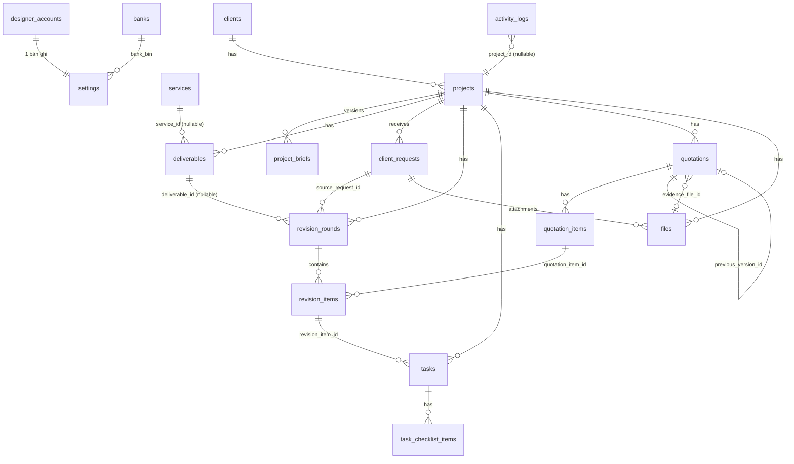

# 04 — Database Design (PostgreSQL 17)

Quy ước:
- Tên bảng/cột `snake_case`, số nhiều cho bảng.
- PK `uuid` (sinh ở app bằng `Guid.CreateVersion7()` — có thứ tự thời gian).
- Tiền: `bigint` (VND). Ngày: `date`. Thời điểm: `timestamptz` (UTC).
- Enum lưu `text` + `CHECK` (dễ migrate hơn enum type của PG). EF map bằng `HasConversion<string>()`.
- Xóa mềm: `archived_at` / `deleted_at`. Không có `ON DELETE CASCADE` trên dữ liệu tài chính.
- `created_at`, `updated_at` mọi bảng nghiệp vụ (EF interceptor set).
- Concurrency: cột hệ thống `xmin` (không cần khai báo trong DDL).

## 1. ERD



## 2. DDL

```sql
-- ============ Account & Settings ============
CREATE TABLE designer_accounts (
    id               uuid PRIMARY KEY,
    email            text NOT NULL UNIQUE,
    password_hash    text NOT NULL,
    security_stamp   text NOT NULL,              -- đổi khi đổi mật khẩu → logout mọi session
    failed_logins    int  NOT NULL DEFAULT 0,
    lockout_until    timestamptz,
    created_at       timestamptz NOT NULL,
    updated_at       timestamptz NOT NULL
);

CREATE TABLE banks (                              -- seed từ danh sách NAPAS
    bin         char(6) PRIMARY KEY,              -- VD '970436' (Vietcombank)
    code        text NOT NULL,                    -- 'VCB'
    short_name  text NOT NULL,                    -- 'Vietcombank'
    name        text NOT NULL,
    active      boolean NOT NULL DEFAULT true
);

CREATE TABLE settings (
    id                       smallint PRIMARY KEY DEFAULT 1 CHECK (id = 1),   -- singleton
    display_name             text NOT NULL,
    contact_email            text,
    contact_phone            text,
    logo_file_id             uuid,
    bank_bin                 char(6) REFERENCES banks(bin),
    bank_account_no          text CHECK (bank_account_no ~ '^[0-9A-Za-z]{4,19}$'),
    bank_account_name        text,                -- IN HOA không dấu
    quotation_prefix         text NOT NULL DEFAULT 'BG' CHECK (quotation_prefix ~ '^[A-Z]{1,5}$'),
    default_validity_days    int  NOT NULL DEFAULT 7  CHECK (default_validity_days BETWEEN 1 AND 365),
    default_deposit_percent  int  NOT NULL DEFAULT 50 CHECK (default_deposit_percent BETWEEN 0 AND 100),
    default_terms            text NOT NULL DEFAULT '',
    digest_enabled           boolean NOT NULL DEFAULT true,          -- P11 BR-94
    digest_hour_vn           int NOT NULL DEFAULT 8 CHECK (digest_hour_vn BETWEEN 0 AND 23),
    updated_at               timestamptz NOT NULL
);

-- P11 (migration 20261112110000): trạng thái chạy của dashboard, tách khỏi settings.
-- Digest chạy nền ghi digest_last_run_date mỗi ngày; nếu ghi vào settings sẽ làm đổi xmin của settings
-- và gây xung đột concurrency giả cho designer đang lưu Cài đặt.
CREATE TABLE dashboard_state (
    id                    smallint PRIMARY KEY CHECK (id = 1),      -- singleton, seed 1 hàng
    digest_last_run_date  date NULL,                                -- ngày VN đã claim digest
    setup_dismissed_at    timestamptz NULL                          -- đã ẩn checklist thiết lập
);
INSERT INTO dashboard_state (id) VALUES (1);

-- feed hoạt động của khách trên dashboard (ORDER BY occurred_at DESC LIMIT n)
CREATE INDEX ix_activity_occurred ON activity_logs (occurred_at DESC);

-- ============ Catalog ============
CREATE TABLE services (
    id                       uuid PRIMARY KEY,
    name                     text NOT NULL,
    description              text NOT NULL DEFAULT '',
    base_price               bigint NOT NULL CHECK (base_price >= 0),
    default_included_rounds  int    NOT NULL CHECK (default_included_rounds BETWEEN 0 AND 50),
    extra_round_price        bigint NOT NULL CHECK (extra_round_price >= 0),
    active                   boolean NOT NULL DEFAULT true,
    created_at               timestamptz NOT NULL,
    updated_at               timestamptz NOT NULL
);
CREATE UNIQUE INDEX ux_services_name_active ON services (lower(name)) WHERE active;

-- ============ Clients ============
CREATE TABLE clients (
    id                    uuid PRIMARY KEY,
    name                  text NOT NULL,
    company               text,
    phone                 text,
    email                 text,
    contact_channel       text,                   -- 'Zalo: 09xx', 'FB: ...'
    notes                 text NOT NULL DEFAULT '',   -- nội bộ
    status                text NOT NULL DEFAULT 'ACTIVE' CHECK (status IN ('ACTIVE','INACTIVE')),
    portal_enabled        boolean NOT NULL DEFAULT false,
    portal_token_hash     bytea,                  -- SHA-256(token)
    portal_token_version  int NOT NULL DEFAULT 0,
    portal_token_created_at timestamptz,
    archived_at           timestamptz,
    created_at            timestamptz NOT NULL,
    updated_at            timestamptz NOT NULL
);
CREATE UNIQUE INDEX ux_clients_portal_token ON clients (portal_token_hash) WHERE portal_token_hash IS NOT NULL;
CREATE INDEX ix_clients_search ON clients USING gin (to_tsvector('simple', coalesce(name,'')||' '||coalesce(company,'')||' '||coalesce(phone,'')));

-- ============ Projects ============
CREATE TABLE projects (
    id               uuid PRIMARY KEY,
    client_id        uuid NOT NULL REFERENCES clients(id),
    name             text NOT NULL,
    design_type      text NOT NULL CHECK (design_type IN
                     ('LOGO','BANNER','POSTER','BRANDING','UI_UX','SOCIAL_MEDIA','PACKAGING','PRINT','OTHER')),
    status           text NOT NULL DEFAULT 'DRAFT' CHECK (status IN
                     ('DRAFT','QUOTED','IN_PROGRESS','ON_HOLD','COMPLETED','CANCELLED')),
    status_reason    text,                        -- lý do ON_HOLD / CANCELLED / reopen
    status_reason_public boolean NOT NULL DEFAULT false,
    start_date       date,
    due_date         date,
    internal_notes   text NOT NULL DEFAULT '',
    archived_at      timestamptz,
    created_at       timestamptz NOT NULL,
    updated_at       timestamptz NOT NULL,
    CHECK (due_date IS NULL OR start_date IS NULL OR due_date >= start_date)
);
CREATE INDEX ix_projects_client ON projects (client_id);
CREATE INDEX ix_projects_status_due ON projects (status, due_date);

CREATE TABLE project_briefs (
    id            uuid PRIMARY KEY,
    project_id    uuid NOT NULL REFERENCES projects(id),
    version       int  NOT NULL CHECK (version >= 1),
    status        text NOT NULL DEFAULT 'DRAFT' CHECK (status IN ('DRAFT','CONFIRMED')),
    content       text NOT NULL DEFAULT '',       -- Markdown
    confirmed_at  timestamptz,
    created_at    timestamptz NOT NULL,
    updated_at    timestamptz NOT NULL,
    UNIQUE (project_id, version),
    CHECK ((status = 'CONFIRMED') = (confirmed_at IS NOT NULL))
);
CREATE UNIQUE INDEX ux_briefs_one_draft ON project_briefs (project_id) WHERE status = 'DRAFT';

-- Brief đã confirm là bất biến (BR-27)
CREATE FUNCTION trg_brief_immutable() RETURNS trigger AS $$
BEGIN
  IF OLD.status = 'CONFIRMED' THEN
    RAISE EXCEPTION 'brief % is confirmed and immutable', OLD.id USING ERRCODE = 'check_violation';
  END IF;
  RETURN NEW;
END $$ LANGUAGE plpgsql;
CREATE TRIGGER brief_immutable BEFORE UPDATE OR DELETE ON project_briefs
  FOR EACH ROW EXECUTE FUNCTION trg_brief_immutable();

CREATE TABLE deliverables (
    id                uuid PRIMARY KEY,
    project_id        uuid NOT NULL REFERENCES projects(id),
    service_id        uuid REFERENCES services(id),
    name              text NOT NULL,
    quantity          int  NOT NULL DEFAULT 1 CHECK (quantity >= 1),
    included_rounds   int  NOT NULL CHECK (included_rounds BETWEEN 0 AND 50),
    extra_round_price bigint NOT NULL CHECK (extra_round_price >= 0),
    status            text NOT NULL DEFAULT 'NOT_STARTED' CHECK (status IN
                      ('NOT_STARTED','IN_PROGRESS','IN_REVIEW','APPROVED','DELIVERED','CANCELLED')),
    due_date          date,
    sort_order        int  NOT NULL DEFAULT 0,
    created_at        timestamptz NOT NULL,
    updated_at        timestamptz NOT NULL
);
CREATE INDEX ix_deliverables_project ON deliverables (project_id, sort_order);

-- ============ Requests & Revisions ============
CREATE TABLE client_requests (
    id               uuid PRIMARY KEY,
    project_id       uuid NOT NULL REFERENCES projects(id),
    deliverable_id   uuid REFERENCES deliverables(id),
    content          text NOT NULL CHECK (length(content) BETWEEN 1 AND 5000),
    source           text NOT NULL CHECK (source IN ('PORTAL','ZALO','EMAIL','PHONE','OTHER')),
    created_by       text NOT NULL CHECK (created_by IN ('CLIENT','DESIGNER')),
    status           text NOT NULL DEFAULT 'NEW' CHECK (status IN ('NEW','TRIAGED','DECLINED')),
    decline_reason   text,
    triaged_at       timestamptz,
    created_at       timestamptz NOT NULL,
    updated_at       timestamptz NOT NULL,
    CHECK (status <> 'DECLINED' OR decline_reason IS NOT NULL),
    CHECK (created_by <> 'CLIENT' OR source = 'PORTAL')
);
CREATE INDEX ix_requests_status ON client_requests (status, created_at DESC);
CREATE INDEX ix_requests_project ON client_requests (project_id);

CREATE TABLE revision_rounds (
    id                 uuid PRIMARY KEY,
    project_id         uuid NOT NULL REFERENCES projects(id),
    deliverable_id     uuid REFERENCES deliverables(id),          -- null = cấp dự án
    round_no           int  NOT NULL CHECK (round_no >= 1),
    source_request_id  uuid REFERENCES client_requests(id),
    received_at        date NOT NULL,
    notes              text NOT NULL DEFAULT '',                  -- nội bộ
    created_at         timestamptz NOT NULL,
    updated_at         timestamptz NOT NULL
);
-- round_no tuần tự trong deliverable; round cấp dự án đánh số riêng trong project
CREATE UNIQUE INDEX ux_rounds_deliverable_no ON revision_rounds (deliverable_id, round_no) WHERE deliverable_id IS NOT NULL;
CREATE UNIQUE INDEX ux_rounds_project_no     ON revision_rounds (project_id, round_no)     WHERE deliverable_id IS NULL;

CREATE TABLE revision_items (
    id                 uuid PRIMARY KEY,
    round_id           uuid NOT NULL REFERENCES revision_rounds(id),
    description        text NOT NULL CHECK (length(description) BETWEEN 1 AND 2000),
    type               text NOT NULL CHECK (type IN ('MINOR','MAJOR','SCOPE_CHANGE','NEW_DELIVERABLE')),
    billing            text NOT NULL CHECK (billing IN ('FREE_FIX','IN_QUOTA','CHARGEABLE')),
    work_status        text NOT NULL DEFAULT 'TODO' CHECK (work_status IN ('TODO','IN_PROGRESS','DONE','CANCELLED')),
    quotation_item_id  uuid,                                       -- FK thêm sau khi tạo quotation_items
    service_id         uuid REFERENCES services(id) ON DELETE SET NULL,      -- BR-46: dịch vụ chọn cho NEW_DELIVERABLE
    created_deliverable_id uuid REFERENCES deliverables(id) ON DELETE SET NULL, -- BR-48: deliverable sinh khi chấp nhận
    scope_override_reason text,
    internal_notes     text NOT NULL DEFAULT '',
    sort_order         int NOT NULL DEFAULT 0,
    created_at         timestamptz NOT NULL,
    updated_at         timestamptz NOT NULL,
    CHECK (billing = 'CHARGEABLE' OR quotation_item_id IS NULL)
    ,CHECK (service_id IS NULL OR type = 'NEW_DELIVERABLE')               -- ck_items_service_type
    ,CHECK (created_deliverable_id IS NULL OR type = 'NEW_DELIVERABLE')   -- ck_items_created_deliverable_type
);
CREATE INDEX ix_items_round ON revision_items (round_id, sort_order);
CREATE INDEX ix_items_quotation_item ON revision_items (quotation_item_id);
CREATE INDEX IX_revision_items_service_id ON revision_items (service_id);
CREATE UNIQUE INDEX ux_items_created_deliverable ON revision_items (created_deliverable_id) WHERE created_deliverable_id IS NOT NULL;
-- migration 20261112090000_AddRevisionItemServiceAndCreatedDeliverable

-- ============ Tasks ============
CREATE TABLE tasks (
    id                uuid PRIMARY KEY,
    project_id        uuid NOT NULL REFERENCES projects(id),
    deliverable_id    uuid REFERENCES deliverables(id),
    revision_item_id  uuid REFERENCES revision_items(id),
    title             text NOT NULL,
    description       text NOT NULL DEFAULT '',
    status            text NOT NULL DEFAULT 'TODO' CHECK (status IN ('TODO','IN_PROGRESS','REVIEW','DONE','BLOCKED')),
    priority          text NOT NULL DEFAULT 'MEDIUM' CHECK (priority IN ('LOW','MEDIUM','HIGH','URGENT')),
    start_date        date,
    due_date          date,
    sort_order        double precision NOT NULL DEFAULT 0,       -- thứ tự trong cột Kanban
    completed_at      timestamptz,
    created_at        timestamptz NOT NULL,
    updated_at        timestamptz NOT NULL
);
CREATE INDEX ix_tasks_project_status ON tasks (project_id, status, sort_order);
CREATE INDEX ix_tasks_due ON tasks (due_date) WHERE status <> 'DONE';

CREATE TABLE task_checklist_items (
    id          uuid PRIMARY KEY,
    task_id     uuid NOT NULL REFERENCES tasks(id) ON DELETE CASCADE,   -- không phải dữ liệu tài chính
    text        text NOT NULL,
    done        boolean NOT NULL DEFAULT false,
    sort_order  int NOT NULL DEFAULT 0
);

-- ============ Quotations ============
CREATE TABLE quotation_sequences (
    year      int PRIMARY KEY,
    last_seq  int NOT NULL DEFAULT 0
);

CREATE TABLE quotations (
    id                   uuid PRIMARY KEY,
    project_id           uuid NOT NULL REFERENCES projects(id),
    kind                 text NOT NULL CHECK (kind IN ('INITIAL','ADDITIONAL')),
    number               text,                       -- gán khi send v1; các version sau copy
    version              int  NOT NULL DEFAULT 1 CHECK (version >= 1),
    previous_version_id  uuid REFERENCES quotations(id),
    title                text NOT NULL,
    status               text NOT NULL DEFAULT 'DRAFT' CHECK (status IN
                         ('DRAFT','SENT','ACCEPTED','REJECTED','SUPERSEDED')),
    issue_date           date,
    expiry_date          date,
    validity_days        int NOT NULL CHECK (validity_days BETWEEN 1 AND 365),
    subtotal             bigint NOT NULL DEFAULT 0 CHECK (subtotal >= 0),
    discount_amount      bigint NOT NULL DEFAULT 0 CHECK (discount_amount >= 0),
    vat_percent          int    NOT NULL DEFAULT 0 CHECK (vat_percent BETWEEN 0 AND 20),
    vat_amount           bigint NOT NULL DEFAULT 0 CHECK (vat_amount >= 0),
    total                bigint NOT NULL DEFAULT 0 CHECK (total >= 0),
    deposit_percent      int    NOT NULL DEFAULT 0 CHECK (deposit_percent BETWEEN 0 AND 100),
    deposit_amount       bigint NOT NULL DEFAULT 0 CHECK (deposit_amount >= 0),
    terms                text NOT NULL DEFAULT '',
    notes_to_client      text NOT NULL DEFAULT '',
    internal_notes       text NOT NULL DEFAULT '',
    snapshot             jsonb,                     -- bất biến sau SENT
    sent_at              timestamptz,
    accepted_at          date,
    accepted_note        text,
    evidence_file_id     uuid,
    rejected_at          date,
    rejected_reason      text,
    payment_status       text NOT NULL DEFAULT 'UNPAID' CHECK (payment_status IN ('UNPAID','DEPOSIT_PAID','PAID')),
    deposit_paid_at      date,
    paid_at              date,
    created_at           timestamptz NOT NULL,
    updated_at           timestamptz NOT NULL,
    CHECK (discount_amount <= subtotal),
    CHECK (status = 'DRAFT' OR (number IS NOT NULL AND snapshot IS NOT NULL AND issue_date IS NOT NULL AND expiry_date IS NOT NULL)),
    CHECK (expiry_date IS NULL OR expiry_date >= issue_date),
    CHECK (status <> 'ACCEPTED' OR accepted_at IS NOT NULL),
    CHECK (status <> 'REJECTED' OR rejected_reason IS NOT NULL),
    CHECK (payment_status = 'UNPAID' OR status = 'ACCEPTED'),
    CHECK (payment_status <> 'DEPOSIT_PAID' OR deposit_percent > 0)
);
CREATE UNIQUE INDEX ux_quotations_number_version ON quotations (number, version) WHERE number IS NOT NULL;
CREATE UNIQUE INDEX ux_quotations_one_live  ON quotations (number) WHERE status IN ('SENT','ACCEPTED');   -- BR-35
CREATE UNIQUE INDEX ux_quotations_one_draft_per_chain ON quotations (previous_version_id) WHERE status = 'DRAFT';
CREATE INDEX ix_quotations_project ON quotations (project_id, created_at DESC);
CREATE INDEX ix_quotations_status ON quotations (status, expiry_date);

CREATE TABLE quotation_items (
    id            uuid PRIMARY KEY,
    quotation_id  uuid NOT NULL REFERENCES quotations(id),
    description   text NOT NULL CHECK (length(description) BETWEEN 1 AND 500),
    details       text NOT NULL DEFAULT '',
    quantity      int    NOT NULL CHECK (quantity >= 1),
    unit_price    bigint NOT NULL CHECK (unit_price >= 0),
    amount        bigint NOT NULL CHECK (amount = quantity * unit_price),
    source_type   text NOT NULL DEFAULT 'MANUAL' CHECK (source_type IN ('MANUAL','SERVICE','DELIVERABLE','REVISION')),
    source_id     uuid,                               -- service_id / deliverable_id / round_id
    copied_from_item_id uuid REFERENCES quotation_items(id),   -- dòng tương ứng ở version trước (BR-47)
    sort_order    int NOT NULL DEFAULT 0
);
CREATE INDEX ix_quotation_items_quotation ON quotation_items (quotation_id, sort_order);

ALTER TABLE revision_items
  ADD CONSTRAINT fk_items_quotation_item FOREIGN KEY (quotation_item_id) REFERENCES quotation_items(id);

-- Quotation đã gửi: chặn sửa nội dung (chỉ cho đổi status/accept/reject/payment fields)
CREATE FUNCTION trg_quotation_locked() RETURNS trigger AS $$
BEGIN
  IF OLD.status <> 'DRAFT' AND (
       NEW.snapshot IS DISTINCT FROM OLD.snapshot OR NEW.total IS DISTINCT FROM OLD.total OR
       NEW.subtotal IS DISTINCT FROM OLD.subtotal OR NEW.discount_amount IS DISTINCT FROM OLD.discount_amount OR
       NEW.vat_amount IS DISTINCT FROM OLD.vat_amount OR NEW.deposit_amount IS DISTINCT FROM OLD.deposit_amount OR
       NEW.number IS DISTINCT FROM OLD.number OR NEW.version IS DISTINCT FROM OLD.version OR
       NEW.terms IS DISTINCT FROM OLD.terms OR NEW.issue_date IS DISTINCT FROM OLD.issue_date OR
       NEW.expiry_date IS DISTINCT FROM OLD.expiry_date) THEN
    RAISE EXCEPTION 'quotation % is locked', OLD.id USING ERRCODE = 'check_violation';
  END IF;
  IF TG_OP = 'DELETE' AND OLD.status <> 'DRAFT' THEN
    RAISE EXCEPTION 'quotation % cannot be deleted', OLD.id USING ERRCODE = 'check_violation';
  END IF;
  RETURN COALESCE(NEW, OLD);
END $$ LANGUAGE plpgsql;
CREATE TRIGGER quotation_locked BEFORE UPDATE OR DELETE ON quotations
  FOR EACH ROW EXECUTE FUNCTION trg_quotation_locked();

CREATE FUNCTION trg_quotation_items_locked() RETURNS trigger AS $$
DECLARE s text;
BEGIN
  SELECT status INTO s FROM quotations WHERE id = COALESCE(NEW.quotation_id, OLD.quotation_id);
  IF s <> 'DRAFT' THEN
    RAISE EXCEPTION 'items of quotation are locked' USING ERRCODE = 'check_violation';
  END IF;
  RETURN COALESCE(NEW, OLD);
END $$ LANGUAGE plpgsql;
CREATE TRIGGER quotation_items_locked BEFORE INSERT OR UPDATE OR DELETE ON quotation_items
  FOR EACH ROW EXECUTE FUNCTION trg_quotation_items_locked();

-- ============ Files ============
CREATE TABLE files (
    id                 uuid PRIMARY KEY,
    project_id         uuid REFERENCES projects(id),          -- null: logo settings
    deliverable_id     uuid REFERENCES deliverables(id),
    request_id         uuid REFERENCES client_requests(id),
    kind               text NOT NULL CHECK (kind IN ('REFERENCE','PREVIEW','FINAL','EVIDENCE','BRIEF','SYSTEM')),
    original_name      text NOT NULL,
    content_type       text NOT NULL,
    size_bytes         bigint NOT NULL CHECK (size_bytes > 0),
    storage_key        text NOT NULL UNIQUE,                  -- 'yyyy/MM/{uuid}' (không chứa tên gốc)
    sha256             bytea NOT NULL,
    visible_to_client  boolean NOT NULL DEFAULT false,
    uploaded_by        text NOT NULL CHECK (uploaded_by IN ('DESIGNER','CLIENT')),
    deleted_at         timestamptz,
    created_at         timestamptz NOT NULL
);
CREATE INDEX ix_files_project ON files (project_id, created_at DESC) WHERE deleted_at IS NULL;
CREATE INDEX ix_files_request ON files (request_id);

ALTER TABLE quotations ADD CONSTRAINT fk_quotations_evidence FOREIGN KEY (evidence_file_id) REFERENCES files(id);
ALTER TABLE settings   ADD CONSTRAINT fk_settings_logo FOREIGN KEY (logo_file_id) REFERENCES files(id);

-- ============ Activity ============
CREATE TABLE activity_logs (
    id                 bigint GENERATED ALWAYS AS IDENTITY PRIMARY KEY,
    occurred_at        timestamptz NOT NULL DEFAULT now(),
    actor_type         text NOT NULL CHECK (actor_type IN ('DESIGNER','CLIENT','SYSTEM')),
    client_id          uuid REFERENCES clients(id),
    project_id         uuid REFERENCES projects(id),
    entity_type        text NOT NULL,                -- 'quotation', 'project', ...
    entity_id          uuid NOT NULL,
    action             text NOT NULL,                -- 'quotation.sent', ...
    data               jsonb NOT NULL DEFAULT '{}',  -- { before: {...}, after: {...}, reason: ... }
    visible_to_client  boolean NOT NULL DEFAULT false,
    client_message     text
);
CREATE INDEX ix_activity_project ON activity_logs (project_id, occurred_at DESC);
CREATE INDEX ix_activity_client  ON activity_logs (client_id, occurred_at DESC);
CREATE INDEX ix_activity_entity  ON activity_logs (entity_type, entity_id);

CREATE FUNCTION trg_activity_append_only() RETURNS trigger AS $$
BEGIN RAISE EXCEPTION 'activity_logs is append-only' USING ERRCODE = 'check_violation'; END $$ LANGUAGE plpgsql;
CREATE TRIGGER activity_append_only BEFORE UPDATE OR DELETE ON activity_logs
  FOR EACH ROW EXECUTE FUNCTION trg_activity_append_only();
```

> Các trigger viết trong EF migration bằng `migrationBuilder.Sql(...)`.

## 3. Ràng buộc nghiệp vụ không thể hiện được bằng DDL (kiểm tra ở Domain)

| Rule | Nơi kiểm |
|---|---|
| BR-41 round cấp dự án không chứa IN_QUOTA | `RevisionRound.AddItem` |
| BR-53 khách chỉ gửi request cho dự án của mình | Portal handler (lọc `client_id`) |
| BR-60 scope guard | `RevisionItem.ChangeWorkStatus` |
| BR-61 không đổi billing khi đã báo giá | `RevisionItem.ChangeBilling` |
| Chuyển trạng thái hợp lệ | `Project.ChangeStatus`, `Quotation.*` |
| `deliverable_id` của round/request/task thuộc cùng `project_id` | Handler validate |

## 4. Truy vấn tham chiếu

### 4.1 used_rounds theo deliverable

```sql
SELECT r.deliverable_id, count(DISTINCT r.id) AS used_rounds
FROM revision_rounds r
JOIN revision_items i ON i.round_id = r.id
WHERE r.project_id = @project_id
  AND r.deliverable_id IS NOT NULL
  AND i.billing = 'IN_QUOTA' AND i.work_status <> 'CANCELLED'
GROUP BY r.deliverable_id;
```

### 4.2 Đang chờ thu (Dashboard)

```sql
SELECT coalesce(sum(CASE q.payment_status
         WHEN 'UNPAID'       THEN q.total
         WHEN 'DEPOSIT_PAID' THEN q.total - q.deposit_amount
         ELSE 0 END), 0) AS outstanding
FROM quotations q JOIN projects p ON p.id = q.project_id
WHERE q.status = 'ACCEPTED' AND p.status <> 'CANCELLED';
```

### 4.3 Số báo giá kế tiếp

```sql
INSERT INTO quotation_sequences(year, last_seq) VALUES (@year, 0) ON CONFLICT (year) DO NOTHING;
UPDATE quotation_sequences SET last_seq = last_seq + 1 WHERE year = @year RETURNING last_seq;
-- (UPDATE tự lấy row lock trong transaction send)
```

## 5. Snapshot JSON (quotations.snapshot)

```json
{
  "schemaVersion": 1,
  "number": "BG-2026-0007",
  "version": 2,
  "kind": "ADDITIONAL",
  "title": "Báo giá phát sinh — Logo vòng 4",
  "issueDate": "2026-11-07",
  "expiryDate": "2026-11-14",
  "designer": { "displayName": "Cam Studio", "email": "...", "phone": "..." },
  "client":   { "name": "Nguyễn Văn A", "company": "ABC Coffee" },
  "project":  { "id": "…", "name": "Nhận diện ABC Coffee" },
  "items": [
    { "description": "Vòng sửa thứ 4 — Logo", "details": "", "quantity": 1, "unitPrice": 200000, "amount": 200000 }
  ],
  "subtotal": 200000, "discountAmount": 0, "vatPercent": 0, "vatAmount": 0, "total": 200000,
  "depositPercent": 0, "depositAmount": 0,
  "terms": "...", "notesToClient": "...",
  "bank": { "bin": "970436", "shortName": "Vietcombank", "accountNo": "0123456789", "accountName": "NGUYEN VAN B" }
}
```

- `bank` được chụp vào snapshot → đổi tài khoản ngân hàng sau này không đổi QR của báo giá đã gửi.
- `schemaVersion` để tương thích khi định dạng snapshot thay đổi.

## 6. Seed

- `banks`: danh sách BIN NAPAS (tối thiểu: VCB 970436, BIDV 970418, VietinBank 970415, Agribank 970405,
  Techcombank 970407, MB 970422, ACB 970416, VPBank 970432, TPBank 970423, Sacombank 970403,
  VIB 970441, HDBank 970437, SHB 970443, OCB 970448, MSB 970426, SeABank 970440, Eximbank 970431,
  LPBank 970449, Nam A Bank 970428, Cake by VPBank 546034, Timo 963388). **Kiểm tra lại với danh sách
  chính thức của NAPAS/VietQR trước khi go-live.**
- `settings` id = 1 với giá trị mặc định.
- `services` mẫu: Logo (2.000.000, 3 vòng, 200.000/vòng), Banner (500.000, 2, 100.000),
  Poster (800.000, 2, 150.000), UI Screen (700.000, 2, 150.000).
